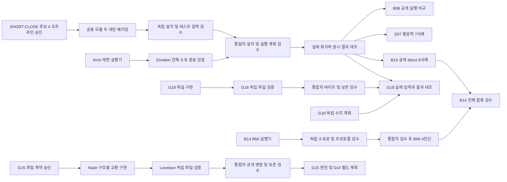

# 로드맵 공정표

**Herdr에서 재개(2026-11-05).** 사용자가 명시적으로 재개했고 Claude Code
Sonnet 5.5 high를 추가 작업자로 허용했다. `HERDR-RESUME-G`에서 지침을 갱신하고
Herdr의 `sonnet-review`를 `SHORT-CLOSE-COMPAT-V`에 배정했다. 첫 작업은 기존
단언을 유지하는 오류 코드 호환성 검토다. 아래 중단 기록과 동결본은 역사 자료로
유지한다. 새 네이티브 실행·제품 병합 승인은 아직 없다.

재개 첫 결과: `HERDR-RESUME-G`는 `81da7b8`, `SHORT-CLOSE-COMPAT-I`는
`c9cbeb5`, 독립 계약 정적 검토 `SHORT-CLOSE-COMPAT-V`는 `dc2764f`다.
[별도 호환성 후보](research/proposals/short-close-compat/README.md)는 기존 CLI
4건과 추가 합성 검사 10건을 통과했다. 오류 코드는 `short`에서만 보존하며
`cleanup_failed` 상태와 원래 종료 불확실성은 유지한다. pump/weir 오류 이름은
변경하지 않는다. 체크포인트 343파일의 크기·SHA-256도 일치했다. 후보의 독립
실행 검수·새 wheel·실행기/판독기 합성 검증·실제 엔진 회귀는 남아 있다.

**사용자 요청으로 중단(2026-11-05).** 이번 경계는 [공용 패키지 최종 검수](research/experiments/SHORT-CLOSE-PACK-G-final-01/verification.json)까지다. 독립 검수 자료 460개와 두 설치본의 제품 191파일을 대조했다. 실제 엔진 재시험·제품 병합은 미완료다. [재개 체크포인트](research/checkpoints/20261105-quota-pause/README.md)에 미병합 코드와 작업자별 중단 상태를 보관한다. 기존 CLI fixture 이관은 4건 중 3건 통과, 공개 오류 코드 호환성 차이 1건이 남아 있다. 아래의 ‘진행 중’ 기록은 중단 직전 상태이며 명시적인 재개 요청 전에는 계속 실행하지 않는다.

**B14 후보 6의 통합 회귀 통과, 독립 검수 대기.** [다섯 합성 검사](research/experiments/B14-RUNNER-G-rev06-consistency-01/verification.json)에서 원래 멤버의 확보 시각과 종료 코드 모순을 거부했고, 이후 관찰 시각만 다른 정상 기록은 허용했다. [파일 사전 검사](research/experiments/B14-RUNNER-G-rev06-preflight-01/verification.json)는 동결 참조 52개와 후보·준비 입력 113파일의 불변을 확인했다. 네 BMI 진단의 실제 실행은 아직 없으며, 공개 direct 여섯 사례는 공용 실행 수정 통합이 선행한다. Faraday의 구현본은 동결했고 Plato가 독립 검수한다.

**B06 판독기 독립 검수 병행.** Mill의 공개 manifest 판독기 `203d9def`가 동결됐다. Faraday는 별도 `B06-PROVENANCE-V-FAR-20261105-01`에서 Einstein이 미리 정한 오류 사례 70개·정상 대조 6개를 기준으로 검수한다. Einstein은 공용 실행의 네이티브 기록 판독기에 집중한다. [통합자의 연결 시험](research/experiments/SHORT-CLOSE-NATIVE-G-interface-01/verification-02.json)에서는 관찰 핸들 닫기 시각과 대조군 허용 상태의 명세 불일치를 두 정상 대조군과 함께 확인했다. 실제 엔진 실패로 집계하지 않으며, 실행기와 판독기를 합친 합성 시험 후 네이티브 실행 여부를 판정한다.

**최종 패키지 동결 대조 완료.** [동결본 통합 검사](research/experiments/SHORT-CLOSE-PACK-G-freeze-01/verification.json)에서 최종 `001c` 자료 484개의 해시·크기를 확인하고 앞서 검수한 `f7eb` 설치 wheel과 연결했다. Plato의 별도 설치 검수는 진행 중이다. Raman은 기존 `test_cli.py`의 네 합성 Job 사례를 별도 폴더에서 먼저 재현한 뒤, 단언을 유지하는 테스트 입력 변경을 준비한다. 실제 엔진 재시험과 제품 병합은 아직 승인하지 않았다.

**검증 준비의 연결 기준.** 새 재현 실행기의 외부 관찰 핸들은 실행 소유자의 최초 핸들과 다르다. 두 핸들을 같은 것으로 표기하지 않고, 생존 중 확보한 관찰 핸들을 계속 보유하면서 PID·생성 시각·실행 파일을 소유자 기록과 대조하도록 Archimedes와 Einstein의 명세를 맞추고 있다. 일반 Job 소속 조회를 특정 소유 Job의 증거로 바꾸지 않는다. G15는 [독립 시험 준비 대조](research/experiments/G15-TRANSFER-G-readiness-01/verification.json)에서 동결 파일 16개와 공개 명령 시험 30개·저장 오류 시험 11개를 확인했다. 실제 후보의 통과 판정은 별도다.

**공용 종료 후보 4 설치 패키지 검수.** [통합자의 설치 검사](research/experiments/SHORT-CLOSE-PACK-G-rev04-01/verification.json)에서 191파일 중 두 실행 모듈만 바뀌고 189파일은 기존 승인본과 같음을 확인했다. wheel RECORD 195항목, 실제 설치 경로, 공개 명령 98개와 JSON 프로토콜 2도 확인했다. 기존 테스트 단언과 구형 거부 사례를 유지한 합성 입력 변경이며, 작성자의 설치 검사 116·49·18개는 통과했다(중복 가능해 합산하지 않음). 최종 패키지 동결 대조는 완료했고 Plato의 독립 검수가 남아 있다. 현재 제품은 기존 191파일 그대로다.

**새 엔진 회귀의 독립 판독 준비.** [기존 검증기의 범위 대조](research/experiments/SHORT-CLOSE-NATIVE-G-admission-gap-01/verification.json)에서 중지 직전 활성 멤버만 확인하는 분류기는 먼저 끝난 자식의 최초 생존 확보 근거를 지운 반례도 통과했다. 이는 기존 분류기의 명시된 범위이며 전체 수명 검증으로 확대할 수 없다. Archimedes는 별도 재현 실행기, Einstein은 제품 판정기를 사용하지 않는 원시 기록 판독기를 준비한다. 최대 12실행·동시 2개·재시도 없음, direct/DIMR 600초와 191변수 비교, 같은 실행 파일을 쓰는 대조군 생존 및 모든 원래 Job·멤버·수집기 닫기를 각각 검수한다. 패키지·판독기·계획의 통합 검수 전까지 새 실행은 없다.

**B14 후보 5 통합 반례.** [통합자의 합성 검사](research/experiments/B14-RUNNER-G-rev05-consistency-01/verification.json)에서 같은 원래 멤버의 복사된 캡처 시각 불일치와 선택적 추가 trace의 종료 코드 모순이 승인됐다. 대조군 두 개는 통과했다. 추가 trace는 현재 생산자가 쓰는 필드가 아니므로 실제 엔진 결함으로 서술하지 않는다. Faraday는 별도 후보 6을 준비하고, Plato가 독립 검수한다.

**B06 추가 입력 경계와 공개 실행 기록 판독.** Mill의 신규 정적 검사 24개가 통과했고 [통합자 검수](research/experiments/B06-RUN-PROFILE-G-bounds-01/verification.json)에서 동결 자료 180개를 대조했다. 121/122개 시각 경계, 이진수로 합쳐지는 서로 다른 시각, 값·파일 크기 상한, 비활성 블록, 격자 범위와 출력 이름 충돌을 확인했다. 이는 공용 실행 수정이나 수치 결과 승인에 포함되지 않는다. 다음 판독기는 Mill의 `B06-V-public-provenance-20261105-01`, 독립 검증은 Einstein의 `B06-PROVENANCE-V-EIN-20261105-01`에서 준비한다. 공개 manifest 3의 실제 direct/DIMR 인자·XML·입력·출력을 원래 형식으로 확인하고 #225의 170변수 비교와 연결한다. 실제 네 실행 및 제품 병합은 여전히 미완료다.

**공용 종료 판정의 독립 사전 사례 확정.** Plato의 [121개 사례 동결본](research/experiments/SHORT-CLOSE-V-rev03-20261105-01/freeze.json)은 기대 승인 23개·거부 98개로 구성됐다. 원래 #227 실패 기록, 먼저 종료된 root와 살아 있는 자식, 살아 있는/종료된 자식의 혼합, 보조 핸들이 원래 증거를 대신할 수 없는 경우를 포함한다. 준비 검사 7개 통과는 수정 구현의 통과를 뜻하지 않는다. Archimedes의 자체 112개 검사 통과 기록과 별개로, 최종 구현 동결본에 독립 판독기를 적용해야 한다.

**B14 후보 4의 저장 오류 회귀 통과.** [같은 두 오류를 새 코드에 주입](research/experiments/B14-RUNNER-G-storage-entry-02/verification.json)해 둘 다 `EvidenceStorageError`와 원래 종료 근거를 반환하는 것을 확인했다. 원래 디스크 기록은 유지됐고 정리 재시도는 없었다. 후보 3의 실패 자료는 보존한다. 이 검사는 저장 경계 두 경우에 한정되며 최종 동결본과 독립 전체 검수가 끝나기 전에는 네이티브 실행을 승인하지 않는다.

**B14 후보 3의 추가 저장 오류 경로.** 통합자가 [최종 상태 기록 직전 재읽기 실패 두 경우](research/experiments/B14-RUNNER-G-storage-entry-01/verification.json)를 재현했다. 저장된 비종료 기록을 재확인할 때 읽기 오류 또는 바이트 불일치가 생기면 일반 예외가 나와 구조화된 오류에서 원래 종료 근거가 빠진다. 기존 디스크 기록은 유지됐고 정리 재시도·네이티브 실행은 없었다. Faraday가 이 경계를 수정하고 Plato가 독립 재검수한다. 작성자가 이전 29개 검사를 재실행해 통과한 결과만으로 새 후보를 승인하지 않는다.

**G15 구조물 교환 계약 승인, 파일 구현 착수.** [수정 계약의 최종 검수](research/experiments/G15-PROPOSAL-G-final-01/verification.json)에서 독립 검증자의 23개 의무·16개 범위 행과 두 수정 사항을 확인했다. 형상 메타데이터의 사용자 지정 연결과 실제 INI 구조물 ID를 구분하며, 단일 StructureFile 이름은 두 엔진 판독 경로의 차이를 반영한다. Nash는 `G15-TRANSFER-I-20261105-01`, Lovelace는 `G15-TRANSFER-V-20261105-01`만 소유한다. 첫 구현은 구조물 조회, 형상·수리 속성 묶음 내보내기와 기존 한 파일 가져오기다. 기존 자산의 명시적 연결·공유 참조·단위·시계·비대상 바이트를 검증하며, 새 파일을 동반한 다중 쓰기는 별도 단계로 남긴다. 공개 제품 병합·엔진·GUI 검증과 전체 G15 승인은 아직 없다.

**G18 수치 검증 준비 승인(실행 전).** Mill의 독립 입력·판독기 동결본을 [통합자가 재검수](research/experiments/G18-NATIVE-PLAN-G-final-01/verification.json)했다. 동결 파일 103개, 입력 지문 60개와 세 쌍의 바이트 일치, 합성 수치 오류 검사 28개를 확인했다. 기존 제품 191파일은 eedd 설치 패키지와 동일하다. 여섯 실제 계산은 미실행이며 공용 종료 판정 수정·설치 검수·새 실행 임대를 선행해야 한다. 이 승인은 계산 결과나 GUI 동등성 승인이 아니다.

각 구현(I)과 독립 검증(V)은 서로 다른 GPT-6.1 Sol / high 에이전트에 배정한다. 마지막 G(통합 검수)는 오케스트레이터가 맡는다. 이 표의 선행 조건은 **통합 승인** 기준이다. 공개 계약이 정해지면 독립 파일의 구현·검증 준비는 병행할 수 있다. 완료 표시는 실제 검수와 재현 근거가 생긴 뒤 붙인다.

**G06 공개 편집·MDU 식별자 통합 승인:** [설치 wheel](research/experiments/PKG-G-G06-MDU-02/verification.json)에서 관측점 4 × 120초, f34 direct/DIMR 600초·191변수, [E009/E011 실패·중단·대조군 생존](research/experiments/MDU-ID-G-E009-E011-158-01/verification.json)을 확인했다. [전체 회귀 및 수정 모듈 재실행](research/experiments/CLI-G-G06-MDU-regression-157-01/verification.json): 1,296개 중 4개는 식별자가 빠진 합성 MPI 테스트 입력 때문에 실패했다. 해당 입력만 수정한 뒤 같은 설치본의 MPI 모듈 37개 전부 통과. 최초 수집 이후 추가한 관측점 테스트 19개도 별도 통과. 이 기록은 두 번째 전체 실행을 뜻하지 않는다.

2026-11-05 B04/B10 통합 후 [전체 테스트 기록](research/experiments/REG-G-boundary-final-01/unittest.log): 1,208개 실행, 3개 건너뜀, 실패·오류 없음(450.493초). [전후 지문](research/experiments/REG-G-boundary-final-01/verification.json)에서 제품·테스트 파일은 같았다. 실행 중 추가된 독립 연구 검증기는 [별도 공개 CLI 대조](research/experiments/B04-PLI-V-policy-consent-02/verification.json)에서 이전 삭제 정책으로 얻은 편집 지문이 현재 정책에서 거부되는지 확인했다. GUI의 버튼 동작은 이 회귀 결과에 포함되지 않는다.

| 노드 | 선행 | 구현자 소유 범위 | 독립 검증자가 확인할 결과 | 통합 상태 |
| --- | --- | --- | --- | --- |
| M1-I/V/G 경계 편집 | M0 | boundary 모듈 | E005의 지원점 3/13, 단위·중복·오래된 지문 거부, 한 숫자 이외의 입력 바이트 보존, 변경·기준군 600초 | 승인 |
| M2-I/V/G 결과 비교 | M1-G의 두 결과 | results 모듈 | 원시 NetCDF 직접 판독과 JSON/CSV 비교, 마스크·단위·좌표·시간 불일치, map 위치와 공간 추출 | 승인 |
| M3-I/V/G 모델 작성 | M1-G, M2-G | create 모듈 | 새 수로 입력 생성·이동·실행·history 추출, 단위/ID/경계 적용 기간 오류 | 승인 |
| M4-I/V/G 공간 입력 | M3-G | mesh/공간 모듈 | E006, 알려진 바닥고·수직 기준·좌표, 연결·세분화·보간·결측 처리, 격자 교체 실행 | 승인 |
| M5-I/V/G 확장 직렬 | M2-G, M3-G | 직렬 프로필·진행 모듈(기존 run 소유권 단독 임대) | E010의 실제 모의시각, 장시간 사례 출력 주기·마지막 시각·취소 대조군 | 승인 |
| 프로젝트 브리지 | E001/E002 | bridge 모듈 | 실제 콘솔 완료 표식과 파일·참조, 실패·저장·재열기. E007 GUI helper는 별도 | 단일 f34 [콘솔 왕복 검수 기록](research/notes/verification/project-bridge.md); 일반 프로젝트 미검증 |
| 재시작 / MPI | M2-G, M5-G | 각각 독립 route; 공용 run 수정 직렬화 | E013 연속 대비 이어 계산 / E012 분할·수치 비교·rank 종료와 대조군 생존 | 직렬 [E013-F](research/notes/verification/restart-trial.md)는 저장 예측값 계약 승인, 기본 원본 동등성 미통과. [E012-R](research/notes/verification/parallel-trial.md)은 조립본을 FM이 실제로 읽어 240초에 도달했고, 최종 34변수가 선언된 오차 안에 들었다. 전체 시계열 동일성은 미승인 |
| 1D / 1D–2D / 3D·구조물 | M3-G, M4-G | 차원별 입력 프로필 | 단면·구조/유입 ID, 교환·수직층·출력 위치를 별도 모델로 확인 | [1D 고정 보·측방 유입 승인](research/notes/verification/network-structures.md). [분기망·혼합망 7건의 부호·저류 수지 승인](research/notes/verification/network-exchange.md). [3층 sigma 염분 수로 승인](research/notes/verification/layers.md). |
| 결합 / BMI worker | 각 모듈 단독 실행, M2-G | coupling 및 worker | E015 조합별 교환량·단위·시계·종료·취소 후 자원 회수, 유사·지형변화 독립 사례 | [07 단독 Waves의 경계 파고·map/his 대조 승인](research/notes/verification/waves.md). 08의 재설계한 세 모델에서 양방향 물리 반응을 통합 승인. [03 내부 수질 과정](research/notes/verification/water-quality.md) 승인. 08 취소·타임아웃·손상 입력 실패에서 다른 실행의 생존과 완료도 승인. [48셀 수로 한 보의 BMI 쓰기·물리 반응·14세션 종료](research/notes/verification/live-worker.md)도 승인. [06 독립 DELWAQ 소비자·사망률 대조](research/notes/verification/water-quality.md) 승인. RTC/RR과 다른 제어값은 별도 |

**충돌 방지:** 공개 명령 등록, 스키마 통합, 패키징, README·로드맵·이 표는 통합 담당자만 편집한다. 구현자는 배정한 제품 파일만, 검증자는 별도 테스트와 재현 스크립트만 쓴다. 네이티브 실험은 새 폴더에 기준 파일을 복사해 순차 실행한다. 다른 작업자의 코드·기존 실험을 덮어쓰지 않는다. 실패하면 같은 소유자에게 돌려보낸 뒤 다시 검수한다.

**검수:** 담당자는 변경 파일과 재현 명령·결과를 제출한다. 통합자는 구현과 독립 검증의 가정을 대조하고 공개 명령으로 성공·실패 경로를 재현한다. 파일 diff·출력값·시각·제한 사항을 확인한 뒤에만 ROADMAP과 GUI 대응표를 갱신한다.

**승인 근거:** [M1–M5 통합 기록](research/notes/verification/roadmap-2d.md). M4 첫 세분화 방식을 반려한 뒤, 수정본에서 먼 셀의 정점 보존·전이 셀 연결·실제 교체 격자 계산을 재확인했다.

**통합 검수 기준점(2026-11-04).** `PKG-G-expanded-roadmap-01`의 wheel을 NetCDF가 없는 새 가상환경에 설치해 공개 명령 68개와 672개 설정 주소를 확인했다. 같은 단계의 전체 테스트는 660개 중 658개 통과, Windows 링크 생성 권한에 의존하는 2개 건너뜀이다. 이후 추가된 RTC 자식 핸들 수집·RR 입력 이관·1초 DELWAQ 사례는 각자 새 검수 대상이다. 이 숫자를 이후 변경의 통과 증거로 쓰지 않는다.

후속 [wheel 검수](research/experiments/PKG-G-exchange-controls-01/verification.json)에서는 NetCDF 없는 새 환경의 설치본에서 명령 69개를 확인했다. 별도의 [전체 테스트 기록](research/experiments/PORT-G-ownership-rr-dt1-01/unittest.stderr.txt)은 706개 중 704개 통과·2개 건너뜀이다. 두 검사는 각각 그 시점의 소스에 대한 결과이며, GUI 재현의 근거로 쓰지 않는다.

[B03·O02 반영 wheel](research/experiments/PKG-G-series-schedule-01/verification.json)은 새 환경에서 71개 명령과 672개 설정 주소를 노출했다. [같은 개발 단계의 전체 검사](research/experiments/PORT-G-series-schedule-01/stderr.txt)는 811건 중 805건 통과, Windows 링크 권한에 따른 3건 건너뜀, 당시 GUI 실행기의 알려진 결함 3건 예상 실패였다. [수정 후 독립 재현](research/experiments/E007-CONTROLLER-V-offline-20261104-02/independent-review.json)에서 비정상 종료·시간 초과 세 결함을 다시 확인했고, 관련 테스트 19건은 예상 실패 없이 통과했다. [통합자가 수행한 오프라인 검사](research/experiments/E007-G-controller-deadlines-02/result.json) 50건도 통과했다. 실제 GUI는 실행하지 않았다.

| 후속 노드 | 통합자가 확인한 근거 | 판정 |
| --- | --- | --- |
| E013-F, E012-R | [직렬 저장 예측값](research/notes/verification/restart-trial.md), [조립 restart의 실제 소비](research/notes/verification/parallel-trial.md) | 각각 명시한 계약만 승인. 기본 원본 배열 비교 결과는 실패로 보존 |
| 독립 DELWAQ 실패 격리 | [손상된 과정 파일과 동일 바이너리 대조군](research/notes/verification/water-quality.md) | 네이티브 오류·대상 종료 후 대조군 생존과 최종 시각 승인. 자연 종료 경합은 강제 취소로 집계하지 않음 |
| RTC/Windows Job | [독립 Python 트리](research/experiments/WIN-TRACE-V-producer-python-20261104-01/verification.json), [통합자의 별도 자식·대조군](research/experiments/WIN-TRACE-G-public-hooks-01/verification.json), [실제 RTC 종료 증거](research/experiments/E015-RTC-V-native-slot63-20261104-01/slot63-released.json) | #63에서 2개 중 2개 종료 확인. [#67/68](research/notes/replay/coupling-cases.md)에서 변경·기본 제어쌍의 10회 수신/전달, 마루·수리반응, 최종 수위와 유량 승인. restart에서 마루 높이 복원은 미승인 |
| RR–FM f152 | [입력·실패 이력, 독립·통합 시험](research/notes/replay/coupling-cases.md) | #71·#72에서 각각 세 사례의 양방향 34개 연결점, 600초 최종 상태와 각 실행의 두 프로세스 종료를 확인. 절대 높이 기준·GUI export는 미검증 |

| 현재 배정 | 구현자 | 검증자 | 통합자가 받는 산출물 |
| --- | --- | --- | --- |
| M1 | Bacon · `boundary*.py` | Nash · `test_boundary.py`, `verify_boundary.py` | 새 기준군·변경군 두 실행의 각 NetCDF와 입력 지문 |
| M2 | Ampere · `results*.py` | Lovelace · `test_results.py`, `verify_results.py` | M1 두 실행의 원시값/CLI 결과 대응 |
| M3 | Faraday · `create*.py`, 예제 입력 명세 | Einstein · `test_create.py`, `verify_create.py`, 합성 격자 fixture | 새 수로 입력, 이동된 파일 세트, 실행·추출 근거 |
| M4 | Mill · `mesh*.py`, 예제 격자 명세 | Nash · `test_mesh.py`, `verify_mesh.py` | M3용 대체 격자와 E006 |
| M5 | Ampere · 직렬 프로필·진행 | Lovelace · `test_extended.py`, `verify_extended.py` | E010 및 확장 직렬 근거 |
| P01–P04 | Bacon · `project*.py` | Einstein · `verify_project.py` | [f34 콘솔 저장·재열기 근거](research/notes/verification/project-bridge.md) |
| P08 · DIMR 구성 exporter | Nash · `dimr_project_export*.py`, 전용 스크립트만 | Raman · `verify_dimr_project_export*.py`, 전용 테스트 | 같은 복제 프로젝트에서 P04의 10파일과 DIMR exporter가 실제로 작성한 XML·구성요소 입력을 비교. 콘솔 지원 여부를 확인하기 전에는 공개 명령을 추가하지 않음 |
| E013 재시작 | Faraday · `restart*.py` | Nash · `test_restart.py`, `verify_restart.py` | 연속/분할/같은 시각 cold 대조, 모든 변수·중복 시각·최종 상태 및 별도 강제 중단 |
| E013-F · 재시작 예측값과 진단량 | Mill · 신규 `restart_forecast*.py`만; 기존 기본 raw 판정은 유지 | Nash · `verify_restart_diagnostics*.py`, `test_restart_diagnostics*.py` | 실제 절단 시각·cold 대조군·모든 이후 예측 필드·최종 상태·원본 진단 차이를 각각 판정. 원본 비교 결과는 바꾸지 않음 |
| E012 MPI | Mill · `parallel*.py` | Lovelace · `test_parallel.py`, `verify_parallel.py` | 실제 설치에서 rank별 소유 증거, 파일 조립, 사전 선언 변수별 비교, 취소 격리 |
| E012-R · 조립한 checkpoint로 재시작 | Raman · 신규 `parallel_continuation*.py`만. 공용 `run`·재시작 연결은 통합자 담당 | Ampere · `verify_parallel_continuation*.py`, `test_parallel_continuation*.py` | 병합본으로 실제 후속 계산, 동일 시각 연속 대조와 최종 상태. 기존 E012 조립 성공만으로 승인하지 않음 |
| NET: 1D/구조물/1D–2D | Ampere · `network*.py`, `examples/network/` | Einstein · `test_network.py`, `verify_network*.py` | 세 모델의 독립 결과, 단면·구조물·측방 유입·교환이 엔진에 적용된 증거 |
| 3D 수직층 | Bacon · `layers*.py`, `examples/layers/` | Nash · `test_layers.py`, `verify_layers*.py` | 서로 다른 층의 초기·경계 입력과 실제 수직 출력 대조 |
| E015 모듈 결합 | Faraday · `coupling*.py`, `examples/coupling/` | Ampere · `test_coupling*.py`, `verify_coupling*.py` | [단독/결합 기준 입력](research/notes/replay/coupling-cases.md)과 시간·단위·교환값. 재시작/NET 제품 수정과 겹치면 선행 노드 수정 우선 |
| 유사·지형변화 | Bacon · `morph*.py`, `examples/morph/` | Nash · 기존 유사 검증기. Ampere · `test_morph_exchange_oracle.py`와 `verify_morph_exchange.py`만(별도 경계 유사량 검증) | [두 수로·8개 사례 승인](research/notes/verification/morph-trial.md): 단면 누적 kg, 열별 건조 저장량, 이동·고정·비활성·정지 대조군, 최종 restart. 독립·통합 각 8건 |
| 라이브 BMI worker / R09 | Faraday · `bmi*.py`, `examples/bmi/` (결합 구현과 순차) | Nash · `test_bmi*.py`, `verify_bmi*.py` (유사 검증 우선) | 독립 프로세스의 실제 init/step/clock/get/set·정상 종료, 중단/실패 자원 회수, 같은 실행 파일 대조군 생존 및 원본 출력 비교. 읽기/시계, 실제 보 제어, 취소·실패 검수는 서로 다른 노드 |
| E015 수질 | Mill · `water_quality*.py`, `examples/water_quality/` (E007과 순차) | Einstein · `test_water_quality*.py`, `verify_water_quality*.py` (E014 우선) | [03 입력·timer·3,600초 원본 농도 대조 승인](research/notes/verification/water-quality.md). 별도 예제 06의 전처리·3,600초 소비자 A/B·13개 시각 농도 및 부피 적분 승인 |
| E014 설정 대응·보존 | Einstein · `fields*.py`, 필드 색인 | Lovelace · `test_fields*.py`, `verify_fields*.py` | [통합 검수](research/notes/verification/fields.md): 672주소 색인 대조 및 48셀 모델에서 설정 세 개의 실제 적용·보존. GUI 세 설정 소유관계는 미확인 |
| B03 · 기존 수위 시계열 편집 | Mill · 신규 `boundary_series*.py`. 공개 명령 등록은 통합자 | Einstein · `test_boundary_series*.py`, `verify_boundary_series*.py` | [두 독립 수로의 총 6개 실행](research/notes/verification/boundary-series.md): 선택한 숫자 이외의 바이트 보존, 실제 경계 응답·모의 종료 후 값만 바꾼 대조군 승인. GUI 조작과 직렬 자식 전체 종료 증거는 별도 |
| O02 · restart 출력 일정 | Faraday · MDU 단일 간격 편집; Nash · `checkpoint_schedule.py`의 시각 판정. 통합자만 공용 실행·출력 경로 연결 | Lovelace · `test_output_schedule*.py`, `verify_output_schedule*.py` | [독립 8회·통합 8회 승인](research/notes/verification/checkpoint-schedule.md). 직접 FM·DIMR의 30초·45초·비활성·30–90초 창 시각을 대조. 기본 최종 restart 정책 유지. 통합 8회 모두 Job 멤버 2개 종료 확인 |
| E015 RTC/RR | Faraday · 기존 `coupling*.py` 소유권; 실행 중인 08 코드 동결 후 순차 반영 | Lovelace · `test_rtc_exchange*.py`와 `verify_rtc_exchange*.py` 전용 | [RTC의 관측→제어→실제 보 높이](research/notes/replay/coupling-cases.md)는 두 구성에서 승인. RR의 생산 유량→lateral 유량·시각을 각 구성에서 원본 출력으로 확인. 08/WQ/BMI와 native 슬롯 공유 |
| 실행의 자연 종료 증거 | Archimedes의 단일 핸들 방식 이후 Raman · `windows_exit_evidence.py`, `windows_job_trace*.py`. 공유 실행기 연결은 통합자 | Lovelace · `test_job_trace_proof.py` 생존/소유/실패 대조 및 실제 RTC 컴포넌트 시험 | #56에서 Job의 누적 프로세스는 2개이나 종료 핸들은 1개였다. 앞으로 확보한 개별 핸들과 누적 수·빈 Job을 대조. 빈 Job만으로 미관찰 프로세스를 종료 확인했다고 쓰지 않음 |
| E015 RR · f152 | Bacon · `rr_f152*.py`, `examples/rr_f152/`만. Faraday의 `coupling*.py` 호출 경계는 통합자 연결 | Lovelace · 정적 FNM 검증, Nash · `verify_rr_f152_native*.py` 실제 수신 검증 | 고정 원본과 실행용 시계 변경을 나눠 기록하고, RR↔FM의 34쌍과 실제 수신 유량·수위를 확인 |
| E007 / R01 GUI Run | Mill · `trace_gui_activity.py`, GUI 전용 실험 스크립트 | Lovelace · `verify_gui_trace.py`, 증거 검사(E014와 순차) | 새 GUI 프로세스·프로젝트의 소유 확인 → helper 인자·로드 모듈·파일 전후 차이·출력 시각. 기존 GUI 세션은 사용하지 않으며 스크립트 호출과 버튼 클릭을 구별 |
| E007 게스트 이관 | Plato · `gui_guest*.py`, `research/assets/gui-guest-bridge/` | Raman · `verify_gui_guest*.py`, `test_gui_guest*.py` | 폐기 가능한 별도 Windows 게스트로 보낼 입력·실험 스크립트·지문, 호스트를 잘못 지정했을 때 거부. 실제 GUI 증거 수집 전에는 런타임 미승인 |
| E007 게스트 전용 실행기 | Plato · `gui_guest_controller*.py`, 전용 자료. 이관 도구의 세 가지 거부 누락부터 수정 | 이관 검증자인 Raman은 Job 구현 후 복귀, 실제 실행 시에는 추가로 독립 증거 확보 | 이관 패키지 해시와 준비 시간, 게스트 SID·로컬 설정·로그 경로, 소유 Job 증거를 모두 확보하기 전에는 실제 GUI 실행을 승인하지 않음 |
| E014 GUI 속성 소유관계 | Faraday · 신규 `fields_project_export*.py`, 전용 자료만; 제품 MDU 필드와 분리 | Lovelace · 전용 독립 재현기와 테스트로, 무변경 대조 및 세 복사본의 실제 exporter/MDU diff를 통합 대조 | 기존 E014 결과는 파일·엔진 대조. 게스트에서 실제 GUI/콘솔 API 소유관계와 export를 보기 전에는 미승인 |
| E014 · 현재 모델에서 편집 가능한지 표시 | Einstein · `fields.py`, `fields_eligibility*.py`만. 스키마·패키징은 통합자 | Nash · `test_field_edit_eligibility*.py`, `verify_field_edit_eligibility*.py` | [독립 75회·설치본 세 입력 최종 검수](research/notes/verification/fields.md) 승인. Chezy f34와 Manning 파생본은 차단, 48셀 수로는 후보값 미리보기 후 허용. 텍스트 조회에는 NetCDF가 필요하지 않음 |
| 짧은 직렬 실행의 종료 증거 | 기존 Job 추적기와 짧은 직렬 실행기의 연결은 통합자만 담당 | Einstein · `verify_serial_exit*.py`, `test_serial_exit*.py`. 기존 E009/E011 재현기 사용 | [독립 12회 및 E009/E011 통합 검수](research/notes/verification/failure-cancellation-experiment.md): 정상·초기화 오류 시 두 핸들 종료, 취소·타임아웃 시 별도 대조군 생존, 소유자 소실 및 600초 191변수 회귀 통과 |

**B09 승인:** B01의 EXT/PLI 조회와 B03의 시계열 판독을 사용한다. Mill(I)은 `boundary_import*.py`, Raman(V)은 공개 명령 테스트·독립 대조군, 통합자는 명령 연결·최종 검수를 담당했다. [원본 증거와 재현 명령](research/notes/verification/boundary-import.md): BC·CSV × 세 모드 모두 목표 BC 하나만 변경했고, 수동 모델과 네 출력 파일의 변수 159개가 일치했다. 별도 수로의 독립 시험 3회와 실제 좌표·기상 파일의 오래된 미리보기 거부도 통과했다. 독립 첫 실행의 BOM 실패를 보존하고, 엔진이 거부하는 조건을 별도 A/B 시험과 공개 응답에 반영했다. GUI 대화상자·클립보드 미검증.

**GUI 실험의 선행 조건:** E014는 P08의 게스트 격리와 프로세스 종료 보증을 재사용할 수 있지만 DIMR 내보내기 성공에 의존해서는 안 된다. 세 필드의 파일 비교 검증기는 독립적으로 준비했고, 이 결합을 제거한 실행기와 실제 게스트 증거를 별도로 검수한다. E007은 Plato가 실제 GUI 진입점의 설정·로그 경로를 판별하는 모듈만, Einstein이 독립 검증기만 담당한다. 사전 경로를 추정하거나 시험용 서명을 생성한 것만으로 실제 GUI 실행을 허용하지 않는다.

초기 0.3.1 회귀 기준은 기존 35개 테스트 통과였다. 공용 명령 등록·실행기 연결은 통합자만 변경한다. 연구 네이티브 실행은 한 번에 한 노드만 수행하며, 실패한 실행 폴더도 보존한다.

B04 내보내기의 선행 노드는 B01(위치·신호 식별)과 B09(지원점별 병합·보존)다. 구현은 새 `boundary_export*.py`(Mill), 독립 검증은 `test_boundary_export*.py`·`verify_boundary_export*.py`(Raman)로 분리한다. 통합자는 전체·경계별·과정별·물리량별 분할이 서로 구별되는 입력에서 원본과 내보낸 신호·단위·좌표를 대조한다. 네 가지 분할과 신호·위치 보존은 [승인](research/notes/verification/boundary-export.md)했다. PLI 교체·좌표 변환과 GUI 대화상자 대조는 별도 노드다.

| 후속 노드 · 선행 | 구현(I) | 독립 검증(V) | 통합 검수(G) |
| --- | --- | --- | --- |
| B04-EXPORT · B01/B09 | Mill: 분할·게시, 임시 폴더 소유 확인 | Raman: 바이트 보존·분류와 동시 작성자 파일 보존 | [3층 수로 네 방식에서 각각 190변수 일치](research/notes/verification/boundary-export.md). 수정 후 동시 작성자 파일 보존, 독립 28개 검사와 설치 배포본까지 승인 |
| JOB-FORCE · E011 | Archimedes: `windows_job.py`의 원래 Job 호출·보유 핸들별 종료 증거 | Einstein: `test_job_force*.py` 및 전용 검증기; 조회 거부·PID 변경·잘못된 반환값 | 통합자는 `runs.py`의 중단 사유 전달 및 [다른 프로세스 핸들 반례](research/workflows/replay/job_member_race.py) 담당. [최종 코어 승인](research/notes/verification/job-force.md). E009/E011 및 600초 191변수 회귀 통과 |
| GUEST-FORCE · JOB-FORCE | Nash: P08/E014 연구 실행기 (제품 Job 코드는 편집하지 않음) | Lovelace: 별도 원시 증거 판독·Python 가족/대조 프로세스 | [#116 독립·#117 통합](research/experiments/GUEST-FORCED-G-accepted-01/verification.json)에서 정상·수집 실패 거부·강제 종료를 승인. #97 실패 보존. 실제 GUI/콘솔은 미검증 |
| B04-PLI · B01/B09, 파일 게시 검수 | Faraday: 새 `boundary_locations*.py`와 예제만. B04-EXPORT와 별도 | Plato: 전용 테스트·독립 대조군. 같은 파일명·선 이름 교체 시 대상 신호만 삭제, 새 선은 무신호, 좌표·공유 신호·원본 보존 | [원좌표 모드 승인](research/notes/verification/boundary-locations.md). 최종 공개 검사 75개. 신호가 BC 끝에 있는 반례를 수정하고 서로 다른 잔존 진폭으로도 159개 변수가 일치 |
| B04-CRS · 수평 좌표 계산 | Archimedes: `boundary_location_crs.py` | Einstein: 독립 UTM 공식·기준점, 축·단위·역변환 및 변환 거부 | [동일 소스 재현](research/experiments/B04-CRS-G-helper-01/verification.json)에서 단위 시험 10개·수치/거부 검사 45개 통과. 수평 좌표 계산만 승인. |
| B04-CRS-PUBLIC · B04-PLI + B04-CRS | Archimedes: 새 `boundary_location_projection.py`에서 대상 망 CRS를 확인하고 XY 토큰 변환. Faraday: 원좌표 소스 승인 뒤 공개 명령에 연결 | Einstein: `test_boundary_location_projection*.py`와 독립 재현기. Plato: 원좌표 회귀 | [승인](research/notes/verification/boundary-locations.md): 공개 변환 27개 사례, UTM 수로 좌표 오차 0.13 mm 이내, 4개 네이티브 실행과 설치 wheel 대조 |
| B10 · B01/B02/B03/B09 | Mill: 새 `boundary_support*.py`와 예제에서 점 비활성화·명시적 신호 활성화·선의 함수 전환 | Raman: 별도 테스트·수동 입력으로 삭제될 신호, 다른 점/선·파일 보존, 시각·단위 검증 | [승인](research/notes/verification/boundary-support.md): 독립 검사 39개. 주석 처리 실패를 수정한 뒤 8개 실행에서 4쌍의 159개 변수가 각각 일치 |
| O03/O04 · 출력 설정과 단독 실행 | Nash: 별도 재현기에서 f34 관측점 형상 출력 켜기와 수지 출력 끄기를 각각 무변경군과 비교 | Lovelace: 별도 검증기에서 shape/NetCDF 원자료와 대조군 검사 | [엔진 측 승인](research/notes/verification/output-toggles.md): 관측점 SHP 5개 레코드와 셀 중심·원좌표, 수지 변수 36개 제거 확인. GUI 및 공개 편집기와 별도 |
| O03/O04-PUBLIC · 위 두 엔진 대조군 | Nash: `model.py` 설정 목록과 기존 값 교체 검사 | Lovelace: 별도 공개 명령 테스트. 통합자는 도움말·설치 wheel과 수동 대조군의 원자료 비교를 담당 | [승인](research/experiments/O03-O04-PUBLIC-G-native-01/release.json). 설치본 테스트 19개, 관련 회귀 87개, 직접 FM 3 × 600초. 공개 편집→원래 값으로 복귀 시 f34 입력 10개 모두 원본과 일치. GUI 체크박스는 별도 |
| B03-ROWS · 기존 B03 조회와 보존 편집 | Mill: 전용 모듈과 요청 예제. 공개 등록 및 wheel은 통합자 | Raman: 별도 모형·공개 명령·영수증, 앞뒤 블록·주석·오래된 지문 검증. Einstein: 두 번째 수로 독립 계산 | [2001년 수로와 공개 명령 승인](research/experiments/B03-ROWS-G-public-native-01/release.json). 수동 대조군과 4 × 120초, 각 159변수 일치. [2026년 5개 실행 재판독](research/experiments/B03-ROWS-G-2026-raw-01/verification.json): 직선 보간 유지 시 수위 불변, 신호 변경에 동쪽 응답. GUI 미검증 |
| G06-OBS · M2 관측점 조회, M3 수로 | Nash: 기존 XYN의 점 이동·추가 수동 입력·실행 | Lovelace: 원시 history의 이름·좌표·수위와 해당 map 셀 비교. 통합자는 세 실행을 별도 재판독 | [파일·엔진 경로 승인](research/notes/verification/observation-points.md): 3 × 120초, 이동·추가한 점과 실제 셀 13시각 일치. map·두 restart의 102변수 보존. GUI·공개 편집기는 별도 |
| G06-OBS-PUBLIC · G06-OBS | Faraday: XYN 조회·추가·이동, 입력 지문과 실제 망 CRS 확인 | Plato: 별도 공개 입력·바이트·경계/밖 거부·낡은 지문 시험. Nash: 설치본 재현기 | [네 번의 설치본 계산](research/notes/verification/observation-points.md): 4 × 120초, 사례당 159변수. 통합자가 실제 엔진에서 256/257바이트의 수용·실패를 확인해 저장 전 거부 추가. 전체 회귀 별도 |
| MDU-ID · 실제 초기화 실패 #147 | Mill: MDU 식별자 판독·검증, 원본/실행용 복사본 검사 | Raman: #153·155 엔진 실측 및 실행 전 거부. Einstein: 영구 테스트 | [설치본 14개 대조 입력과 f34 회귀](research/notes/verification/fm-model-identity.md). 섹션 선택, 정확한 Program 값, 형식 버전 오류를 구분. direct/DIMR 600초 191변수 일치 |
| G12-ORI · G06, f34 직렬 기준군 | Mill: `replay/section_orientation.py`, 기존 `Entrance` 단면 정점 순서만 바꾼 입력 준비 | Lovelace: `verification/verify_section_orientation.py`, 유량·누적량·형상 및 비대상 결과 불변을 독립 판독 | [#159 실제 파일·엔진 판정 승인](research/notes/verification/section-orientation.md). f34 2 × 600초, 11시각 모두 부호 반전·면적 유지, 비대상 불변. GUI 미검증 |
| G12-SECTION-PUBLIC · G12-ORI | Mill: 별도 준비 폴더의 기존 관측 단면 조회·역순 편집 모듈. G10과 별도 파일 | Lovelace: 별도 모형·이름 및 바이트 보존·원복·입력 지문 거부 대조 | [설치 패키지에서 반전·원복 각각 600초/191변수 일치](research/notes/verification/spatial-transfer.md). [독립 파일 검수](research/experiments/G12-SECTION-PUBLIC-V-live-20261105-02/acceptance.json)와 영구 테스트도 통과해 이 범위 승인 |
| G10-XYN · G06-OBS-PUBLIC | Faraday: 별도 준비 폴더의 `observation_transfer*.py`에 단독 XYN 내보내기·가져오기. 기존 입력과 CLI 등록은 통합 전까지 동결 | Plato: 별도 모형으로 이름 충돌·낡은 지문·범위 밖 좌표·파일 보존·재연결 후 history 확인 기준 작성 | [설치 패키지에서 추가·삭제·이동 각각 120초/159변수 일치](research/notes/verification/spatial-transfer.md). [독립 공개 파일 시험](research/experiments/G10-XYN-V-stage-01/integration-01/public-01/verification.json) 통과. 두 명시 모드 승인; GUI 충돌 정책 미측정 |
| G10-GEOM · G06-OBS-PUBLIC, G10 가져오기의 선행 | Archimedes: 관측점 하나와 여러 점이 공용으로 쓰는 망·CRS 판독 모듈. Faraday는 가져오기용 공간 색인만 소유 | Raman: 기준 모델과 수천 셀 격자로 망 판독 횟수·셀 판정·시간·메모리 측정 | [단일점 공개 미리보기 바이트 동일](research/experiments/G10-GEOM-G-review-01/after.json). [48셀·4,096셀 독립 측정](research/experiments/G10-BATCH-V-live-02/verification.json): 묶음당 망 열기 2회·품질 검사 1회 승인. CRS 할당은 별도 개선 |
| G11-DRY · G06, O03 형상 출력 | Nash: 합성 수로에서 건조 다각형 하나의 포함 여부만 바꾼 파일·엔진 사례 | Einstein: 실제 map 셀·history의 지점·shapefile 기록과 진단을 독립 대조 | [설치 패키지·독립 원출력 검수 승인](research/notes/verification/spatial-transfer.md). 두 모델 모두 120초. 1셀 제외, centre 13개 결측, upstream 동일 위치 활성. 첫 검증 실패 보존. GUI 미검증 |
| B11-COEFF · B01/B03, M0 속성표 | Archimedes: 두 경계선의 시계열에서 한 선의 배율 또는 오프셋만 바꾼 파일과 동등한 수동 신호 작성 | Mill: 독립 원자료 판독기로 원래 자료·유효 신호·양쪽 선과 history/map 비교. GUI exporter는 별도 | [8개 모델 원자료](research/notes/verification/boundary-coefficients.md)로 다섯 등가쌍의 값·마스크, 배율·오프셋의 실제 수위 반응 확인. GUI는 별도 |
| B11-PUBLIC · B11-COEFF | Nash: 전용 BC 파서·절대 계수 보존 편집 | Einstein: 별도 공개 명령·거부/보존 대조군 50건 | [설치본에서 3개 편집본과 수동 모델을 120초/159변수 대조](research/notes/verification/boundary-coefficients.md). 최종 wheel의 파일 편집도 승인 |
| G11-ASSIGN · G11-DRY | Faraday: 별도 준비 폴더의 `results stations` 후보 | Plato: 별도 원자료 대조·결측과 형상 불일치·읽기 제한 | [설치본 재현](research/experiments/G11-ASSIGN-G-installed-02/verification.json) 29건: 정상·판정 불가·거부, 파일 보존 확인. CLI 실행 결과 판독 승인; GUI 추정은 미검증 |
| CRS-IO · G10-GEOM, B04-CRS | Lovelace: CRS 입력을 확인할 때 상한 전체를 할당하지 않는 판독기 | Raman: 동일 바이트·해시·교체 거부와 메모리 전후 측정 | [128점, 48/4,096셀 할당 최고치 감소](research/notes/verification/spatial-transfer.md)와 기존 교체·지문 거부 검수 통과 |
| G13-PUMP · G07, G13 작업표 | Archimedes: `replay/pump_orientation.py` 및 새 모델 3개. 제품 파일 접근 없음 | Mill: `verification/verify_pump_orientation.py`와 독립 물수지·방향 판정 | [#175 실제 3회, 독립·통합자 원자료 대조](research/notes/verification/pump-orientation.md). 용량 0 정지 확인; 위치선 반전으로 양수 방향이 뒤집힌다는 예측과 4링크의 총 1 m³/s 예측은 기각 |
| G13-RUNNER · G13 입력·판정 기준 고정 | Nash: 펌프 실험 전용 복사·소유 프로세스 실행기 | Einstein: 실행 허가·경로·입력 변조·종료 증거의 독립 검사 | #175에서 3회 모두 원본 6파일 보존, 자연 종료 코드 0, 소유 Job 비움·종료 확인. 연구 실행기 범위만 검수 |
| G13-PUBLIC · G13-PUMP | Faraday: 별도 폴더에서 펌프 조회·선 반전 후보 | Plato: 별도 모델로 목표 바이트·원복·다른 소비자 보존/거부 확인 | 위치선 반전을 양수 방향 반전으로 공개하는 안은 #175로 기각. 조회 전용 기능은 아래 별도 노드 |
| G13-READ · G13-PUMP | Faraday: 별도 스테이징에 읽기 전용 pump inspect, 기존 제품 미변경 | Plato가 독립 시험을 작성했다. 실행 담당은 Einstein: 입력 불변·모호한 참조 거부·수리 효과를 예측하지 않는 응답 검사 | **조회 승인.** [독립 18시험·55회 호출](research/experiments/G13-READ-V-EIN-corrected-results-20261105-040103-51b9468e/verification.json)의 모듈 4개가 [설치 wheel](research/experiments/G13-READ-G-staged-wheel-01/verification.json)과 같다. [제품 명령](research/experiments/G13-READ-G-root-01/verification.json)으로 세 복사본의 입력 6개와 원본 불변 확인. 반전은 미지원 |
| G13-DRIVE · G13-PUMP | Archimedes: 새 pump_drive_controls 모듈에서 기준, orientation만 음수, capacity만 음수인 입력 | Raman: 새 verify_pump_drive 모듈에서 고정 동서 유량·양쪽 저장량과 자연 거부 구분 | [#177 독립·통합 검수](research/notes/verification/pump-orientation.md). 각각 서쪽으로 480 m³ 이동. 양쪽 저장량 및 120초 restart 대조. 4링크의 총 1 m³/s 가설은 기각 |
| G13-DRIVE-RUNNER · G13-RUNNER, G13-DRIVE | Nash: 별도 run_pump_drive 어댑터. 기존 #175 준비·재현기 수정 금지 | Lovelace: 어댑터의 입력 불변·소유권·종료 증거와 변경된 사본 거부 | [수정 실행기 독립 검사 67건](research/experiments/G13-DRIVE-V-adapter-review-02/verification.json), [실제 3회 종료·원본 입력 지문](research/experiments/G13-DRIVE-RUNNER-I-G-native-177-01/verification.json) 확인 |
| G13-SINGLE · G13-PUMP; 계산은 G13-DRIVE 판정 이후 | Archimedes: 별도 pump_single_link 모듈과 입력 복사본. 같은 물리 범위에서 횡방향 네 셀을 한 셀로 구성 | Mill: 별도 폴더에서 단일 교차 링크·양쪽 면적·변경 파일·동서 유량과 저장량 예측을 독립 검수 | [단일 링크·양쪽 면적 대조](research/experiments/G13-SINGLE-V-predeclared-01/geometry-audit.json) 후 [5회 실측 승인](research/catalog/pump-single-link-gates.json). 양수/음수/0의 총유량 크기가 1/1/0 m³/s였고 선만 반전한 경우 실제 방향은 그대로였다. 네 링크 결과와 구별 |
| G13-SINGLE-RUNNER · G13-SINGLE, G13-DRIVE-RUNNER | Nash: 단일 링크 다섯 모델에 사용할 일반 함수와 실험별 입력 검사 | Lovelace: 별도 검증기로 실측 좌표·물수지·restart·소유 프로세스 증거 대조 | [실행 계획 독립 검수](research/experiments/G13-SINGLE-RUNNER-V-final-copy-20261105-01/prepared183-review-01/verification.json) 후 #183에서 5개 Job 자연 종료·빈 Job 확인. [원본 물수지·양 끝 restart 검수](research/experiments/G13-SINGLE-G-raw-183-01/readback.json) 완료 |
| G13-EDIT · G13-READ, G13-DRIVE | Faraday: 스테이징에서 기존 구조물의 명시적 방향 또는 용량 토큰 하나의 편집 | Einstein: 별도 입력으로 옵션 배타성, 요청 지문, 비대상 바이트 보존 및 거부 재현 | [교체 시 Windows 접근 권한 상속이 바뀐 재현](research/experiments/G13-EDIT-G-security-review-01/verification.json). [수정 후보 33개 시험](research/experiments/G13-EDIT-V-replay-descriptor-20261105-045640-9c4e524a/verification.json), [실제 설치본 권한 검사 8회](research/experiments/G13-EDIT-V-installed-20261105-051042-7a65ac49/verification.json) 통과. 보호된 ACL 사전 거부와 지원하는 파일의 권한 보존을 확인. [세 편집 결과의 바이트 대조](research/experiments/G13-EDIT-G-staged-wheel-02/verification.json) 완료. [#187의 설치 CLI·수동 대조](research/notes/verification/pump-orientation.md#public-pump) 후 제품에 반영 |
| G16-CREST · G07, G16, 기존 2D 보 실험 | Archimedes: `replay/weir_crest_series.py`, 새 입력 복사본에서 CSV 시계와 FM 마루 높이 강제 입력의 연결 확인 | Mill: `verification/verify_weir_crest_series.py`, 상수 두 경우와 시간 변화의 시각·단면 유량·관측소 및 물수지 독립 대조 | [다섯 입력 세트와 CSV→TIM의 분 단위 시각](research/experiments/G16-CREST-G-input-review-01/verification.json) 검수 완료. [#185 다섯 실제 계산](research/notes/verification/weir-crest-series.md)은 120초까지 완료. 초기 TIM 마루 0 m 및 원본 변수 차이로 완전한 상수 등가성은 미통과. GUI CSV 교환 미검증 |
| G16-CREST-RUNNER · G16-CREST, 공통 직렬 실행기 | Archimedes: 보 입력·변경·시각 조건만 담당. 공통 실행기 변경은 Nash만 담당 | Raman: 보 입력의 외부 참조·공유 BC·실행 소유권을 별도 복사본으로 검사. 수리 검증은 Mill | [실제 53개 입력과 검증기 검사](research/experiments/G16-CREST-RUNNER-V-final-11/actual-candidate-verification.json) 후 #185에서 5개 소유 Job이 자연 종료. 실행기 검수를 통과해도 수리 검증 미통과 기록은 유지 |
| G13-RUN-PROFILE · G13-READ, G13-DRIVE, G13-SINGLE | Archimedes: 보 프로필 인계 후 별도 스테이징에서 펌프 입력 수집·검사 모듈. 공통 실행기 수정 권한 없음 | Raman: 보 실행기 검수 후 별도 복사본에서 파일 이름·위치 변경, 입력 누락·별칭 거부, 원본·스테이징 무결성과 시간 검수 | [설치본의 6개 모델 대조](research/experiments/G13-RUN-PROFILE-G-baseline-01/verification.json)에서 일반 검사에 빠진 두 파일을 확인. `--profile pump-scalar`는 [입력 검사 77건](research/experiments/G13-RUN-PROFILE-V-final-10/verification.json)과 #187의 direct 계산 후 승인 |
| G13-INTEGRATION-REPLAY · G13-EDIT, G13-RUN-PROFILE | Nash: 별도 폴더에 설치 CLI 명령만 쓰는 편집·실행 재현기. 독립 엔진 실행기 추가 금지 | 기존 #177·#183의 원본 NetCDF와 비교하며 Raman의 프로필 검증·Einstein의 편집 권한 검증을 선행 | [설치한 공개 명령 다섯 사례](research/experiments/G13-INTEGRATION-REPLAY-I-G-native-187-01/verification.json)와 [원본 출력 독립 판독](research/experiments/G13-INTEGRATION-REPLAY-V-20261105-01/native-readback-G-187-01/verification.json) 통과; 제품 반영 |

**펌프 편집·실행의 합류 순서:** 편집기와 6개 입력 수집 모듈을 각각 검수한 뒤, 실행기의 종료 기록까지 한 wheel에 통합한다. 제품 파일 반영과 실제 FM 실행 권한은 통합자가 관리한다.

[B13의 3D 경계 편집](research/notes/collection/gui-workflows.md#vertical-boundary)은 이 실행기와 파일을 공유하지 않는다. G13 재현기·편집 시험을 인계한 뒤 Nash는 별도 B13 후보 폴더에서 기존 염분 셀의 조회·편집을, Einstein은 별도 검증 폴더에서 같은 점·높이·시각의 수동 대조군을 작성한다. 공개 명령 등록과 실제 계산은 별도 통합 검수 뒤에만 진행한다.

| 노드 | 구현 / 독립 검증의 쓰기 범위 | 합류 조건 |
| --- | --- | --- |
| G13-RUN-LIFECYCLE | Faraday: 별도 후보 폴더의 `runs.py`·종료 처리 모듈. Mill: [별도 검증 폴더](research/experiments/G13-RUN-LIFECYCLE-V-predeclared-01/plan.json) | 원래 Job이 프로세스를 처음부터 추적했는지, 모든 멤버가 종료했고 원래 핸들을 닫았는지 확인한 뒤 최종 상태를 기록. 강제 종료의 원래 사유도 보존 |
| G13-INTEGRATION-REPLAY | Nash: 설치한 공개 명령으로 5개 복사본 편집·실행. Lovelace: 별도 판독기로 수동 모델과 대조. Einstein: [휴대 가능한 편집 회귀 시험](research/experiments/G13-EDIT-V-portable-20261105-052506-248bf5ab/handoff.json) | 통합자가 wheel과 원본 해시를 확인하고 전용 실행 순번을 배정. 120초 도달, 최종 restart, 유량·저류와 네 NetCDF의 변수·마스크 대조 후 승인 |

**G13 이전 설치본 검수:** [wheel·검증 기록 지문](research/catalog/coefficients-stations-gates.json). `0.4.0.dev1` 패키지 파일 162개를 작업 트리와 대조했다. f34 direct/DIMR 600초·191변수와 실패/취소 17개 검사군이 통과했고, [전체 회귀](research/experiments/COEFF-ASSIGN-G-all-173-01/stderr.txt)는 1,487건 중 1,484건 통과·Windows 심볼릭 링크 권한에 의존하는 3건 건너뜀이다. G13은 이 패키지의 지원 범위에 포함되지 않는다.

**G13 조회를 추가한 설치본:** [파일 지문과 검수 기록](research/catalog/pump-inspect-gate.json). 보관된 조회 시험 21개와 공통 CLI 시험 24개가 통과했다. [direct FM·DIMR](research/experiments/G13-READ-G-serial-179-01/verification.json) 모두 최종 600초와 restart를 확인했고 4개 출력의 191변수가 같았다. [실패·취소 17개 검사군](research/experiments/G13-READ-G-failures-181-01/verification.json)도 통과했다. 이 실행 회귀는 f34 대상이며 펌프 모델을 기본 실행 프로필에 추가한 것이 아니다.

**G13 편집·실행 승인:** [근거와 지문](research/catalog/pump-public-gate.json). 원래 Job의 종료와 그 결과의 디스크 저장은 별도 검수했다. 기존 f34 [직렬 두 경로 600초·191변수](research/experiments/G13-PUBLIC-G-serial-189-01/verification.json)와 [실패·취소 17개 검사군](research/experiments/G13-PUBLIC-G-failures-191-01/verification.json)도 통과했다.

| 후속 노드 | 구현자 / 독립 검증자 | 통합자가 확인할 근거 |
| --- | --- | --- |
| G13-STOP · 중단 진단 | Faraday: 펌프 종료 처리 한 파일. Mill: [보관된 사실로 재현한 17개 사례](research/experiments/G13-PUBLIC-STOP-V-patch-01/REPORT.md) | [#195·197·199의 원래 기록](research/experiments/G13-PUBLIC-STOP-V-results-01/report.md)과 비교한다. 원래 Job을 닫은 사실, 중단 전부터 끝나 있던 자식, 타임아웃·취소 사유를 따로 기록해야 한다. |
| B13-EDIT · 3D 경계 한 셀 | Nash: 경계 편집 모듈 3개. Einstein: [편집 중 소스 파일을 읽지 않는지 포함한 독립 시험](research/experiments/B13-EDIT-V-rev02-results-20261105-074230-af758f61/verification.json) | 후보 2의 17개 시험은 임시 등록 환경에서 통과했다. 실제 wheel의 명령 등록·편집과 원본 9개 파일 대조는 별도로 검수한다. |
| B13-RUN · 변경 효과 | Archimedes: 3개 복사본과 공개 명령 재현기. Lovelace: 독립 NetCDF 판독기. 쓰기 경로를 분리하고 네이티브 실행 순번은 통합자만 배정한다. | 무변경·수동 편집·CLI 편집 모델을 각각 20초까지 실행한다. 수동/CLI의 전체 결과 일치와 무변경군에서 달라진 관측점·층을 구분한다. |

**통합 판정:** G13-STOP은 [#201 정상 종료·타임아웃](research/experiments/G13-STOP-G-native-201-01/verification.json)과 펌프 회귀 64건을 통과했다. B13-EDIT와 B13-RUN은 [#203 입력·출력 판정과 패키지 지문](research/catalog/vertical-boundary-gate.json) 범위에서 승인했다. GUI 셀 편집은 미검증이다.

**B12 작업 분담:** Raman은 입력 신호 미리보기와 자체 시험을 `B12-PREVIEW-I-*`에, Mill은 시간축·단위·보간·성분 위상과 연결 상태를 대조하는 독립 기준을 `B12-PREVIEW-V-*`에 작성했다. 통합자는 설치본의 실제 응답을 대조한 뒤 명령을 등록했다. 계산 후 관측 수위를 경계에서 처방한 입력의 정답으로 쓰지 않는다.

| 병행 노드 | 구현 / 독립 검증 | 통합 조건 |
| --- | --- | --- |
| B12-ENGINE · 실제 처방 수위 | Faraday: 전용 worker와 복사한 입력. Plato: 시간·계수·기대 배열의 독립 기준 | 공개 FM에는 [경계 수위 배열](https://github.com/Deltares/Delft3D/blob/5a4649830b1e5072caf019fb4850bbdefd9ad431/src/engines_gpl/dflowfm/packages/dflowfm_lib/include/bmi_get_var.inc#L173)과 [배열 크기 조회](https://github.com/Deltares/Delft3D/blob/5a4649830b1e5072caf019fb4850bbdefd9ad431/src/engines_gpl/dflowfm/packages/dflowfm_lib/include/bmi_get_var_shape.inc#L190)가 있다. 설치 엔진에서 같은 시각의 실제 배열을 읽고 비교해야 실행 근거로 인정한다. |
| G16-SERIES · 보 마루 CSV/TIM | Nash: 구조물 ID와 TIM을 연결하는 조회·교환 후보. Lovelace: 시각·높이 단위와 비대상 자료의 독립 대조 | [기존 5개 수동 모델](research/notes/verification/weir-crest-series.md)에 비춰 시간 원점, 변경된 행, 0초 초기화와 계산 중 마루를 구별한다. GUI CSV 동등성은 별도다. |
| B06-SOURCES · 단일 방류 / 연결 취·방류 | Raman: 별도 B06-SOURCES-I 폴더에서 EXT/PLI/BC 조회·작성과 모델 준비. Mill: 별도 B06-SOURCES-V 폴더에서 수동 입력과 수량·염량 대조 | [B06의 매뉴얼과 FM 소스 차이](research/notes/collection/gui-workflows.md#source-sink)를 출발점으로 위치 표기, 유량·염분 키, 실제 물·염분 이동을 구별한다. 제품 등록·실제 실행 순번은 통합자가 맡는다. |
| B12-ENGINE-T0 · 초기화 직후의 값 | Faraday: 별도 초기화 실험에서 계산 간격을 한 항목씩 바꾼다. Plato: 독립 폴더에서 어떤 결과가 가설들을 구별할지 실행 전에 기록 | [#209 원시값](research/catalog/boundary-prescribed-array.json)을 보존한다. 최초 update 전 시각·전체 벡터와 update 뒤 벡터를 각각 읽고, 소유 핸들 종료를 별도로 검수한다. |
| G16 설치·실행 대조 | Archimedes: G16-SERIES-PACK 폴더에서 B12 기반 wheel 작성. Einstein: G16-SERIES-REPLAY 폴더에서 무변경·수동 변경·공개 CLI 변경 대조군 준비. Lovelace는 독립 판독만 담당 | 최초 후보는 다른 보의 반복 메타데이터도 거부했다. 두 번째 후보를 설치한 뒤 편집 대상 밖의 바이트 보존과 실제 마루·유량 반응을 확인한다. |

G16 후보 2는 마루값을 여러 개 바꿀 때 값마다 TIM 전체를 다시 조립했다. [1,000개 행의 입력으로 잰 결과](research/experiments/G16-SERIES-G-patch-bench-01/verification.json), 바이트 조립 시간 중앙값은 212 ms였고, 앞에서부터 한 번에 조립하면 같은 바이트를 0.25 ms에 얻었다. 파일 읽기·검사·게시·엔진 시간은 이 측정에 포함되지 않는다. 후보 3은 해당 조립을 한 번의 순회로 처리한다. 같은 1,018,890바이트·1,000행을 사용한 [후보 간 비교](research/experiments/G16-SERIES-I-20261105-rev03/patch-assembly.json)에서 210.58→0.38 ms였고 출력 바이트가 일치했다.

**G16-SERIES 파일 편집 통합 승인.** Nash의 후보 3, Archimedes의 wheel, Lovelace의 [설치 명령 독립 검증](research/experiments/G16-SERIES-V-20261105-01/installed-rev03-public-01/verification.json)과 [통합자의 예제 원복](research/experiments/G16-SERIES-G-example-01/checked-01/verification.json)을 대조했다. 185개 제품 파일이 검수한 wheel과 일치한다. `weir-series` 실행 프로필은 별도 노드다. 구현자는 사본에서 실행 경로를 연결하고, 검증자는 입력 11개·작업 소유권·출력 시각을 독립적으로 대조한다. G16 GUI CSV 교환은 아직 미검증이다.

**G16-RUN-PROFILE 통합 승인 (#217/#219).** 구현 Nash, 패키지 Einstein, 독립 검증 Lovelace, 최종 검수 및 루트 반영은 통합자가 맡았다. [실제 공개 명령과 원본 수치 대조](research/notes/verification/weir-crest-series.md#public-run)에서 4×189개 변수, 별도 펌프 회귀 검사에서 5×173개 변수가 일치했다. `weir-series`는 direct 전용이며 취소나 DIMR의 새 실증 범위를 주장하지 않는다.

| 후속 노드 | 구현 소유권 | 독립 검증 및 병합 조건 |
| --- | --- | --- |
| B06 · 취·방류 | Raman: `B06-I-PUBLIC-*`의 전용 모듈·공개 명령 후보. 원본 공유 파일에는 쓰지 않는다. | Mill: `B06-V-PLI-*`의 독립 좌표·PLI 대조군. [#215의 키별 실제 반응](research/notes/verification/source-sink.md)을 보존하고 실패한 입력 표기는 별도 판정한다. |
| B12 · 초기 경계값 | Faraday: 12초 출력 간격을 쓰는 여덟 입력과 실행기. | Archimedes: 실행 소유권, Plato: 초기 배열·시각과 원본 수치. [#221 여덟 실측](research/notes/verification/boundary-preview.md#native-221)과 독립 판독을 완료했다. 관측된 초기 시각 차이를 기록하되 사용자 입력 시계는 유지한다. |
| B14 · 분조 일괄 지정 | Nash: 별도 `B14-I-*` 모듈·테스트·등록 패치. | Einstein: 별도 `B14-V-*`에서 A0·M2, 지원점 선택 범위, 단위, 무변경 대조 및 실제 엔진 입력 검증. B02 진폭 편집의 승인은 승계하지 않는다. |
| S07 · 풍속별 항력 계수 | Archimedes: 별도 `S07-I-*`에서 기존 두 기준점 계수의 조회와 보존 편집. | Lovelace: `S07-V-*`에서 풍속·풍향 파일을 고정하고 두 기준 풍속 사이 응력과 무풍 대조를 독립 검사. GUI 변경 후의 export는 별도. |
| B06-RUN-PROFILE · 취·방류 공개 실행 | Raman: 통합된 191파일을 기준으로 별도 `B06-RUN-PROFILE-I-*`에서 전용 프로필과 공용 코드의 작은 패치만 작성. `source-sink`의 direct/DIMR 경로를 각각 준비한다. | Mill: #225의 여섯 입력·170변수 원본과 대조할 사전 기준. 초기·최종 restart, 활성 입력 6개와 보존된 비활성 BC, 원래 실행 소유권을 구별한다. 실제 실행 순번과 최종 병합은 통합자만 담당한다. |

B14의 입력 편집 후보는 187파일 기반의 별도 wheel에서 독립 32개 검사·74회 공개 명령을 통과했다. 실제 천문 성분 판독은 별도 단계다. Einstein은 A0/M2의 시각·위상과 원자료 기준, Faraday는 새 `B14-RUNNER-I-*`, Plato는 `B14-RUNNER-V-*`의 실행 소유권 검증을 맡는다. S07은 Archimedes의 별도 패키지와 Lovelace의 풍응력 판독을 사용한다. **이전 후보의 CLI 파일을 현재 루트에 복사하지 않는다.** 각 명령 등록 패치를 현재 191파일 기준에 적용하고 결합 패키지를 다시 확인한다. 전체 회귀 검사 중 제품 파일에는 쓰지 않는다.

**현재 결합 후보와 공용 실행 수정(2026-11-05).** B14와 S07은 각각 현재 191파일을 기반으로 194파일·100명령의 별도 패키지를 만들었다. 두 후보 모두 기존 B06 명령을 보존하며, 서로의 새 명령을 포함하는 최종 통합본은 아니다. 입력 편집 검수와 실제 엔진 검수는 별도다. S07 준비에서 기본 `short` 실행이 원래 Job의 `close()` 반환을 버리고 종료 전에 `completed`를 기록하는 경로를 확인했다. 단순한 사후 JSON 저장 패치만으로는 종료 실패 판정을 해결하지 못하므로 다음 노드를 추가한다.

| 노드 · 선행 | 구현(I) | 독립 검증(V) | 통합 검수(G) |
| --- | --- | --- | --- |
| SHORT-CLOSE · 원래 Job/멤버 종료 근거 | Archimedes: 별도 `SHORT-CLOSE-I-*`에서 공용 실행 변경 제안·테스트. 기존 S07 패키지는 보존. | Plato: 종료 실패·예외·기록 실패와 완료 게시 순서를 독립 검사. S07의 물리 검증은 Lovelace가 유지. | 통합자: `runs.py` 변경을 B06-RUN-PROFILE과 직렬 병합. 실제 종료 반환과 수집기 종료 확인 전 완료 판정을 허용하지 않음. 수정 패키지와 bounded 회귀를 통과한 뒤 S07 실행 허용. |

네이티브 임대는 #228 해제 상태다. #227의 수정 후보 2는 다섯 사례 뒤 종료 판정 회귀로 멈췄으며, 원래 Job 5개·멤버 10개 종료와 실제 닫기를 확인한 뒤 임대를 반환했다. B14 실행기와 G18 구현은 파일 작업으로 병행하며, 다음 임대는 통합자의 새 코드·입력·판독기 검수 후 하나에만 부여한다. 후보를 만드는 일과 실행 허가는 구분한다.

[SHORT-CLOSE 결함 재현과 수정 계약](research/notes/verification/serial-close.md): 통합자의 닫기 실패·예외 3건과 원시 알림 변형 2건, 독립 검증자의 19개 오류 주입 검사를 근거로 사후 JSON 저장만 하는 제안을 반려했다. 공용 알림 판독기는 한 번만 수정하고 B06과 공유한다. [S07 설치 편집의 통합 검수](research/experiments/S07-G-combined-editor-01/evidence/verification.json)는 세 숫자 변경·복사·원위치 적용의 8입력 보존을, [B14 두 기준일의 통합 검수](research/experiments/B14-G-combined-inputs-01/evidence/verification.json)는 수동 입력과 8파일 일치를 통과했다. 이 두 입력 검수는 엔진 결과 승인과 구별한다.

G18 관측 단면 단독 가져오기·내보내기는 [계약 통합 검수](research/experiments/G18-PROPOSAL-G-20261105-01/verification.json)를 통과했다. 고정 제안의 55개 파일과 소스 5개를 다시 대조했고, Lovelace의 독립 계약 검수를 확인했다. Nash는 `G18-TRANSFER-I-*`에서 구현하고 Lovelace는 `G18-TRANSFER-V-*`에서 독립 검증한다. 두 작업자는 각자 실험 폴더만 쓰며 기존 G12와 루트 코드는 수정하지 않는다. 단독 PLI export/import의 선택·이름 충돌·append/replace·좌표 선언·바이트 보존·동의 해시·게시 실패를 검증한 뒤 통합자가 CLI/schema를 합친다. 실제 엔진 및 GUI 단독 교환은 별도 단계이며 G12나 XYN 교환의 승인을 전용하지 않는다.

**SHORT-CLOSE 수정 후보 2.** [정확한 동결본 통합자 재검사](research/experiments/SHORT-CLOSE-G-frozen-review-03/verification.json)는 36개 파일의 해시, 원래 pump/weir 종료 기록 9건, 잘못된 알림·타입·시각·종료 플래그 거부와 비정상 종료 코드 8의 구분을 통과했다. 코드 8의 수명 종료 근거가 충분해도 계산 성공으로 승격하지 않는다. 후보 2는 강제 종료에 선택적으로 붙은 trace도 원래 요청의 Job과 동일한 PID/생성 시각 집합에 연결한다. 구현자 93개 검사와 독립 오류 주입 검수, Raman의 깨끗한 191파일 설치 패키지 및 통합자의 설치 코드 93개 검사는 통과했다. 이후 실제 엔진 회귀 #227에서 아래 문제가 발견되어 제품 병합과 후속 결합 패키지 승인을 보류했다.

**후속 실제 회귀 #227: 후보 2 병합 보류.** 독립 오류 주입·설치 검수와 통합자의 실제 설치 93개 검사 뒤, `23f9daa7…` 패키지로 12개 예정 사례 중 5개를 실행했다. direct 정상은 600초·최종 restart, 잘못된 망과 빈 BC는 실제 `failed`를 기록했다. 타임아웃 대상과 대조군 정리는 이미 종료된 자식의 이미지 재조회 실패 때문에 `cleanup_failed`가 됐다. [원자료와 판정 차이](research/notes/verification/serial-close.md)에 기록했으며 의도한 취소 사례와 DIMR는 실행하지 않았다. 원래 보유 핸들 10개와 Job/수집기 5개 닫기를 확인해 임대만 해제했다. 후보 3의 구현은 Archimedes, 독립 검증은 Plato다. 수명 종료 근거와 이번 요청에 의한 강제 종료 귀속을 분리하되 근거 없는 PID를 받아들이지 않는다. Raman의 B06 및 Einstein의 B14 결합 패키지, Archimedes의 S07 결합 패키지는 이 수정에 의존하며 현재 루트 191파일은 그대로 유지한다.

**현재 병행 작업의 합류 조건.** 모든 제품 변경은 사설 후보 폴더에서 준비하고 루트·공용 CLI는 통합자만 수정한다. 네이티브 실행은 아래 어느 분기든 하나의 독점 임대를 사용한다. 대기 중인 분기를 이유로 별도 입력·판독 검증까지 중단하지 않는다.

G18 구현은 Nash, 파일·게시 검증은 Lovelace, 후속 엔진 입력·결과의 독립 계획은 Mill이 맡는다. [통합자의 설치 명령 12회](research/experiments/G18-TRANSFER-G-installed-01/verification.json)는 f34의 전체/선택 내보내기, 원위치 무변경 가져오기, 새 단면 추가, 줄바꿈·꼬리 주석 보존, 충돌·오래된 동의 거부를 통과했다. 후보 196파일 중 기존 189파일은 같다. 파일 검수만으로 GUI나 계산 결과를 승인하지 않는다. Mill은 기준/전체 왕복, 수동/공개 append, 수동/공개 replace의 여섯 사례를 사전 준비하며 실제 실행은 공용 종료 수정 이후다.

[G18 파일 작업 최종 검수](research/notes/verification/section-transfer.md)는 독립 G18 검사 39개·부모 식별자 2개·기존 G12 회귀 24개를 통과했다. 통합자가 최종 동결본 469파일과 기존 루트 191파일의 불변도 다시 확인했다. 후보의 입력 편집만 승인한 상태이며 실제 엔진·GUI 동등성·루트 병합은 별도다. Nash/Lovelace는 사용 예와 병합용 문서·회귀 테스트를 별도 폴더에서 준비한다.

B14의 네 BMI 진단은 Faraday의 별도 실행기와 Einstein의 동결된 수치 판독을 사용한다. Plato의 전체 소유권·프로토콜 검수 뒤 통합자가 별도 임대를 판단할 수 있다. 이는 공개 `short` 여섯 실행과 다른 분기이며 네 진단만으로 B14 전체를 승인하지 않는다. 현재 진행 중인 검수에는 실행 권한이 포함되지 않는다.

**B14 실행기 후보 2 반려.** [독립 전체 검수](research/experiments/B14-RUNNER-V-20261105-04/final-review-01.json)의 29개 검사에서 11개 단언이 실패했다. 비정상 알림을 정상 계산으로 받아들이는 경로, 닫기 예외 무시, 원래 시작 핸들과 마지막 root의 연결 누락, 격리·시각 모순, 저장 실패 시 원시 닫기 근거 누락을 고쳐야 한다. 시간 제한 검사 11개와 [통합자의 파일 전용 10사례 검사](research/experiments/B14-RUNNER-G-file-preflight-01/verification.json)는 통과했지만 전체 실행 승인으로 전용하지 않는다. Faraday는 새 후보 3을 준비하고 Plato가 독립 재검수한다. 새 네이티브 실행은 없다.

**G18 엔진 대조 입력 준비.** [통합자 입력 대조](research/experiments/G18-NATIVE-PLAN-G-inputs-01/verification.json)에서 여섯 사례의 60파일 지문과 세 쌍의 정확한 바이트 일치를 확인했다. replace는 Entrance의 기존 좌표 8행만 역순으로 바꾸고, append는 두 번째 단면의 좌표 0·2·4·6행으로 별도 이름의 단면을 추가한다. 모든 사례에서 다른 9입력은 같고 최종 시각은 600초다. Mill의 최종 판독기·동결본 및 수정된 실행 패키지 확인 전에는 실행하지 않는다.

SHORT-CLOSE 후보 3은 #227의 두 프로세스 형태나 오류 31만 통과시키는 예외를 만들지 않는다. 통합자가 원래 실행기의 코드를 대조해 이미 끝난 root, 살아 있는 자식과 먼저 끝난 자식의 혼합, 보조 정리 핸들이 생기는 경로를 확인했다. Archimedes는 멤버별 원래 수명 근거를 확인하는 구현을, Plato는 대응 합성 반례를 병행한다. 보조 핸들은 누락된 원래 멤버 근거를 채우지 못하며 원시 기록의 false·unknown 값은 그대로 남긴다.

**B06 수동 입력 대조 #223 완료, 제품 병합은 보류.** Faraday의 실행기와 Plato의 독립 종료 검수, Mill의 입력·수치 검증을 분리했다. 첫 실행기는 손상된 종료 증거 17건을 잘못 받아들여 거부했다. 수정본은 독립 37개·작성자 27개 검사 뒤 실행했다. [열 사례의 120초 결과](research/notes/verification/source-sink.md#native-223)와 원래 Job 10개·멤버 20개의 종료를 통합자가 다시 읽었다. `salinityDelta`의 제한된 효과와 PLI/좌표 등가성만 확인했고 절대 농도 키의 실패는 유지했다. 공개 편집 후보 1의 NUL 쓰기 오류는 실제 파일로 재현했다. Raman의 수정 후보 2는 설치 명령으로 잘못된 텍스트 거부·전 파일 보존을 독립 검증한 뒤, 공개 명령이 만든 입력을 별도 엔진 대조해야 한다. GUI export는 이 결과로 승인하지 않는다. 실행 뒤 추가된 두 오류 검사는 판정기의 역방향 알림 연결 누락을 드러냈다. [#223 원본의 사후 대조](research/experiments/B06-PLI-G-readback-223-01/bidirectional-verification.json)는 40개 알림·식별 이벤트의 일대일 대응을 통과했다. 실행 후보의 이력은 유지하고 후속 실행기에는 해당 수정을 포함한다.

**B06 공개 입력 명령 통합 승인 (#225).** 구현 Raman, 독립 입력·수치 Mill, 연구 실행기 Faraday, 독립 실행 소유권 Plato, 최종 코드·수치 검수와 루트 병합은 통합자가 맡았다. [독립 설치 검사 158건](research/experiments/B06-V-public-install-results-01/verification.json), [실행기 58건](research/experiments/B06-PUBLIC-RUNNER-V-20261105-02/final-review-01.json), 수치 판독기 18개 사전 검사를 각각 통과했다. [실제 여섯 사례](research/notes/verification/source-sink.md#public-225)는 각각 120초·170변수 대조를 통과했다. 제품 파일 191개가 검수한 eedd wheel과 같고 portable 테스트 30개도 루트에서 통과했다. [전체 회귀](research/experiments/B06-PUBLIC-G-merge-01/regression.json)는 1,697건 중 1,661건 통과, 36건 건너뜀, 실패·오류 0건이다. 건너뛴 이유는 선택 geo 의존성 33건과 Windows 심볼릭 링크 권한 3건이다. 공개 명령은 98개다. `run start`의 취·방류 프로필과 GUI export는 후속 노드로 남긴다. 실행 순번 225는 원래 여섯 Job과 멤버 12개 종료를 확인한 뒤 226 idle로 반환했다.

[#211 최종 검수](research/catalog/weir-series-public-gate.json). 원본/무변경과 수동 상승/CLI 상승 두 쌍에서 각각 189개 변수가 일치했다. 4 × 120초, 원래 Job 4개·멤버 핸들 8개 종료 확인. 80~120초 동쪽 유량은 평균 40.466 m³/s 줄고 하류 수위는 0.06663 m 높아져, 미리 정한 수위 감소 가설은 실패했다. 공개 `run start` 프로필은 이 연구 실행기로 승인하지 않는다.

B12 초기화 실행기 1차 검수에서는 [가짜 dispatch 경로도 받아들이는 문제](research/experiments/B12-T0-G-authority-probe-01/verification.json)를 재현했다. 네이티브 프로세스를 만들기 전 발견했으며 이 후보에는 실행 순번을 주지 않았다. Faraday가 권한 파일과 소유자 확인을 수정하고 Archimedes가 독립 검증한다.

수정본은 지정된 dispatch·소유자·새 출력 폴더만 허용했다. [통합자의 거부 검사](research/experiments/B12-T0-G-authority-probe-02/verification.json)와 [독립 검수 51건](research/experiments/B12-T0-RUNNER-V-20261105-02/verification.json)을 통과한 뒤 [#213](research/notes/verification/boundary-preview.md#native-213)을 실행했다. A는 11초까지 실측했고 B는 `HisInterval=10`과 `DtUser=4` 조합에서 초기화에 실패했다. 6개 미실행, 원래 두 Job과 멤버 4개 종료 확인. 8개 조건 비교 승인 전 모든 경우에 공통인 출력 간격으로 다시 준비한다.

[B13 설치본 전체 테스트](research/experiments/B13-G-release-regression-01/verification.json): `geo`까지 설치한 별도 환경에서 1,569건 중 1,566건 통과, 실패·오류 없음. 나머지 3건은 Windows 심볼릭 링크 생성 권한이 없어 건너뛰었다. 제품 파일 178개가 테스트 전후로 검증된 wheel과 일치했다.

**B12-PREVIEW 승인 · 파일 입력의 조회·계산.** [최종 검수](research/catalog/boundary-preview-gate.json)에서 Raman의 후보 2, Mill의 독립 입력 판독 시험 37건과 설치 명령 18회, 통합자의 별도 수로·f34 및 보정 블록 대조를 확인했다. 세 모듈과 명령 등록을 통합했고 제품 파일 181개가 검수한 wheel과 같다. [사용 방법과 값](research/notes/verification/boundary-preview.md). [별도 B12-ENGINE #209](research/notes/verification/boundary-preview.md#native-209)에서 세 원래 Job의 종료를 확인했다. 모든 시각·모든 경계값 비교는 평탄한 대조군만 통과했다. 선형·조화 신호의 0초 불일치는 그대로 남기며, 초기화 시각의 원인 조사는 후속 노드에서 담당한다.

**회귀 및 재현성:** 같은 B13 wheel에서 [f34 direct/DIMR 600초·191변수](research/experiments/B13-RELEASE-G-serial-205-01/verification.json)와 [오류·취소 17개 검사군](research/experiments/B13-RELEASE-G-failure-207-01/verification.json)을 통과했다. 두 경로 모두 별도 대조 프로세스가 살아 있었다. 제품 예제는 보관된 모델 없이 입력을 재생성한다. 기존 연구 재현기는 보관된 대조 자료를 사용한다. 후속 B13-PORTABILITY는 [새 체크아웃에서 대조 입력 3개 준비](research/notes/verification/layers.md#portable-b13)까지 승인했다. Archimedes가 별도 모듈을 구현하고 Einstein이 기존 재현기 없는 환경과 거부 조건 25건을 검증했다. 통합자가 입력 9개와 BC 바이트를 대조했다. #203 기존 모듈과 수치 검증 기록은 그대로다.
