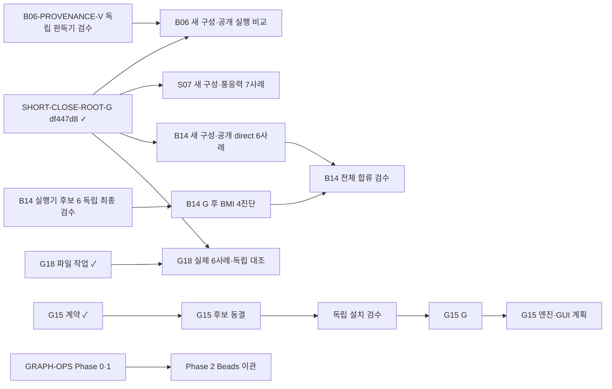

# 공정표

활성 공정의 **현재판**이다. 2026-11-06 이전의 단계별 서술 기록은
[공정 기록](research/notes/delivery/history-to-20261106.md)에 원문 그대로 보존했다.
과거 판단의 근거가 필요하면 그 문서를 노드 ID로 검색한다.

- **갱신자:** 코디네이터 하나([COORDINATOR.md](COORDINATOR.md)). 작업자는 결과 영수증만 제출한다.
- **상태의 단일 원본:** Beads 이관(INTENT Phase 2) 전까지는 이 문서다. 이관을 마치면
  활성 상태·의존성은 Beads만 갱신한다. 이 문서에는 승인 기준점과 Beads에서 만든 보고만 남긴다.
- **기록 방식:** 노드가 닫히면 아래 표의 행을 고치고 「최근 승인」에 한 줄을 더한다.
  상세 판단은 해당 검증 노트나 실험 영수증에 쓰고 여기에는 링크만 둔다.

## 승인 기준점

| 항목 | 현재 값 |
| --- | --- |
| 제품 | `SHORT-CLOSE-ROOT-G` (`df447d8`). 검증 wheel `e32bf84f…`의 종료 모듈 두 개만 반영, 제품 191파일이 wheel과 일치 |
| 공개 계약 | 명령 98개, JSON 프로토콜 2, manifest 3, 기본 물리 프로필 불변 |
| 전체 회귀 | 1,715개 중 1,679 통과, 기존 환경 조건 36 건너뜀, 이후 호환성 3건 통과 ([기록](research/proposals/short-close-native-gates/root-verification.json)) |
| 실제 엔진 | #231 direct/DIMR 각 6사례, 원래 멤버 24개 종료, 600초·최종 restart, 원본 191변수 일치 ([`3851697` 검수](research/proposals/short-close-native231-review/RELEASE_VERDICT.md)) |
| 거부 보존 | #229는 관찰 tick 동률로 `NOT_ACCEPTED`. 원본 192파일 유지 ([해제 검수](research/proposals/short-close-native229-review/RELEASE_VERDICT.md)) |
| 네이티브 슬롯 | `idle232` (`NATIVE231-REPLAY-G` `2af0673`). 실행 허가가 아니다 |

승인 범위는 f34 2D UTC cold-start 600초, direct와 단일 FM DIMR까지다. 강제 종료의
인과 귀속, 정상 마무리, 사용 가능한 restart, 다른 모델·CRS·MPI·결합·GUI 동등성은
승인하지 않았다.

## 활성 Epic

모든 후보는 현재 191파일 제품을 기준으로 **새로 구성**한다. 과거 `23f9` 또는 구형 제품을
기반으로 한 결합 wheel을 승인본으로 재사용하지 않는다. 체크포인트의 후보 코드는
[중단 체크포인트](research/checkpoints/20261105-quota-pause/README.md)와 그 `dispatch.json`에 있다.

| Epic | 현재 후보·근거 | 다음 노드 (Ready 우선) | 선행 관문 |
| --- | --- | --- | --- |
| GRAPH-OPS · 공정 관리 전환 | [INTENT](INTENT.md), [COORDINATOR](COORDINATOR.md) | **Ready:** Phase 0 현황 점검, Phase 1 격리된 Beads 시험 → 사용자 보고 | 없음. Phase 2 이관은 보고 승인 후 |
| B06 · 취·방류 | 공개 기록 판독기 Mill `203d9def` 동결. 작성자 82통과는 독립 근거가 아니다. [#225 공개 입력](research/notes/verification/source-sink.md#public-225) | **Ready:** `B06-PROVENANCE-V`. Einstein이 미리 정한 오류 70·정상 6 사례로 독립 검수 → G. 이어서 `B06-RUN-PROFILE-I` 새 구성 → #225의 6입력·170변수와 direct/DIMR 대조 | SHORT-CLOSE-ROOT-G ✓. 실제 실행은 새 임대 필요 |
| B14 · 분조 일괄 지정 | 실행기 후보 6 `2641efa9`, 계획 `15e9acca`. G 합성 5건·파일 사전검사 통과. V 75건 통과, 최종 판정 미봉인 | **Ready:** 독립 최종 검수 → G. 이후 BMI 4진단(별도 임대), 새 구성의 공개 direct 6사례, 전체 합류 검수 | SHORT-CLOSE-ROOT-G ✓. 4진단만으로 B14 전체를 승인하지 않는다 |
| S07 · 풍속별 항력 계수 | [설치 편집 통합 검수](research/experiments/S07-G-combined-editor-01/evidence/verification.json): 8입력 보존 | 새 구성 → 풍응력 7사례 엔진 검수(Lovelace 판독) | SHORT-CLOSE-ROOT-G ✓. 입력 검수와 엔진 승인은 별개 |
| G15 · 구조물 교환 | [계약 승인](research/experiments/G15-PROPOSAL-G-final-01/verification.json). 후보 package-02 작성자 17건 통과, 이후 추가분은 미검증·미동결 | 정확한 후보 동결 → 독립 설치 검수(준비된 공개 30·저장 오류 11) → G. 엔진·GUI는 별도 계획 | 16개 범위와 미지원 항목 유지 |
| G18 · 관측 단면 교환 | [파일 작업 최종 검수](research/notes/verification/section-transfer.md) 통과(입력 편집만). [수치 계획 승인](research/experiments/G18-NATIVE-PLAN-G-final-01/verification.json), 6사례 미실행 | 새 구성 → 임대 → 6사례 실행과 Mill 독립 대조 → 루트 병합 G | SHORT-CLOSE-ROOT-G ✓. GUI 동등성은 승인 범위 밖 |

## 공정 규칙

역할(I/V/G), Git 커밋 단위와 공용 파일 소유는 [AGENTS.md](AGENTS.md)를 따른다. 작업
배정, 모델 선택, 임대와 복구는 [COORDINATOR.md](COORDINATOR.md)를 따른다. 공개 명령
등록, 스키마 통합, 패키징, README·ROADMAP·이 문서는 코디네이터만 편집한다. 실제 엔진
실행은 어느 분기든 한 번에 하나의 독점 임대를 쓴다. 임대를 기다리는 분기라도 입력 검증과
판독기 검증은 계속 진행한다.

이전에 승인된 범위(M1–M5, P01–P04, E012–E015, B01–B13, G06–G16, O02–O04 등)의 근거는
[검증 노트](research/notes/verification/)와 [공정 기록](research/notes/delivery/history-to-20261106.md)에 있다.

## 최근 승인

| 노드 | 커밋 | 근거 |
| --- | --- | --- |
| SHORT-CLOSE-ROOT-DOC | `607c61c` | 재개 문서와 다음 관문 기록 |
| SHORT-CLOSE-ROOT-G | `df447d8` | 제품 통합. 종료 모듈 두 개 반영 |
| SHORT-CLOSE-ROOT-V | `0ceb728` | [통합 독립 검수 27항목](research/proposals/short-close-root-review/REVIEW.md) |
| NATIVE231-REPLAY-G | `2af0673` | [합류 승인과 임대 해제](research/proposals/short-close-native-gates/release231.json) |
| NATIVE231-RELEASE-V | `3851697` | [실제 회귀 37항목](research/proposals/short-close-native231-review/RELEASE_VERDICT.md) |
